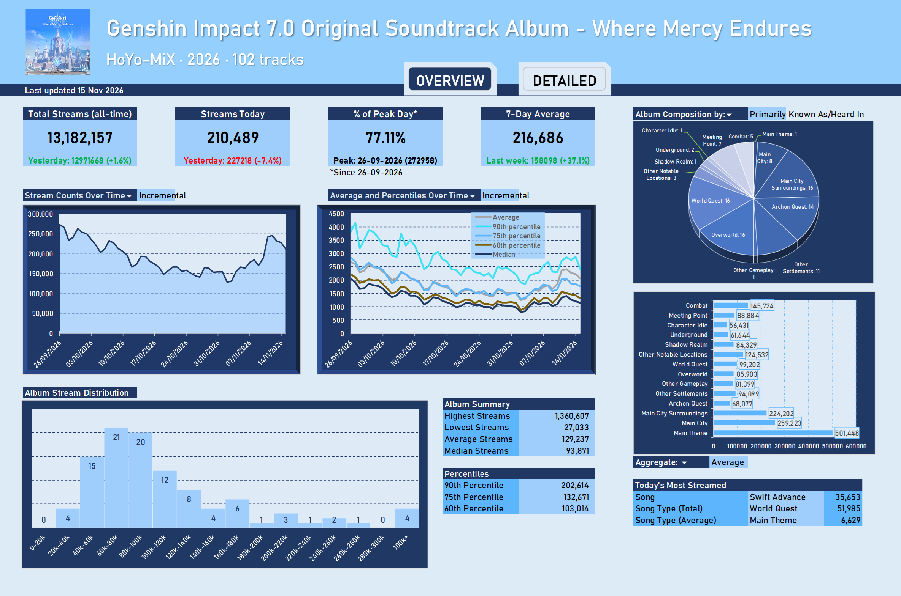
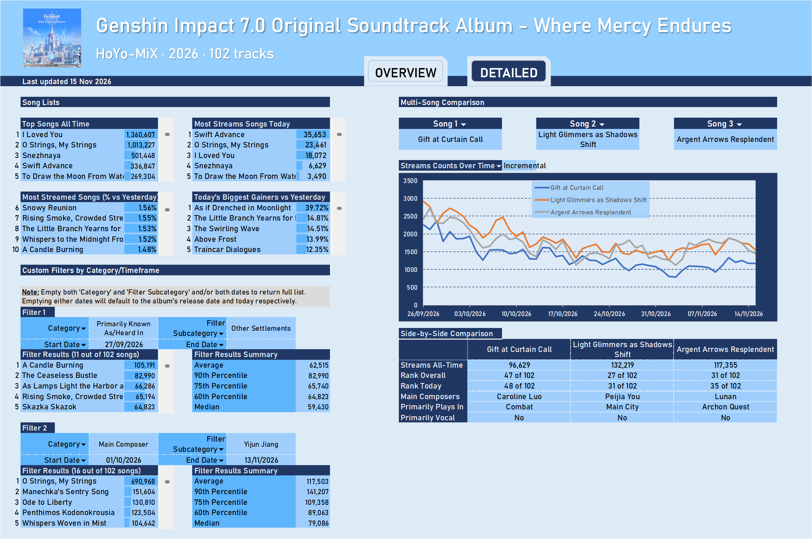

# Description
Excel-based interactive dashboard to display various analytics for Genshin Impact's 7.0 Album "Where Mercy Endures".
The dashboard consists of two main pages: the first for "KPI's" and general overview, whereas the second one for more detailed lists as well as custom searches and comparisons.

# Main Features
1. Album KPI's
2. Over time progression charts, with a Cumulative/Incremental dropdown option.
3. Album composition (pie chart), with a dropdown for Categories.
4. Album stream distrbution (Histogram)
5. More detailed lists for best performing songs, with a scroll bar to navigate through the full 102 tracks.
6. Custom song comparison (up to 3) with line charts and side-by-side comparisons.
7. Custom search filters, with a customizable category, subcategory, and time frame.

# Notes
- No macros are used. All functionality is made using built-in formulas.
- Data collection is taken directly from Spotify's stream counts and is updated manually. The Excel file available in this repository is only a snapshot on 16 November 2026 and is not automatically synchronized with my local file.
- Album's release date on Spotify on 14 September 2026, whereas data collection only began at 25 September 2026.

Warning: This project was created using Excel 2021. Opening on Google Sheets or previous versions of Excel might cause the file to break.

# Basic Methodology
1. Raw data is manually inputted each day into a table in the form of cumulative stream counts, which is how Spotify displays them.
2. Using lookup functions such as XLOOKUP and INDEX-MATCH, numerous analytics are retrieved and calculated to be displayed in the dashboard.
3. Helper ranges in a separate intermediate sheet are used to dynamically reflect user's dropdown selections or update charts.

